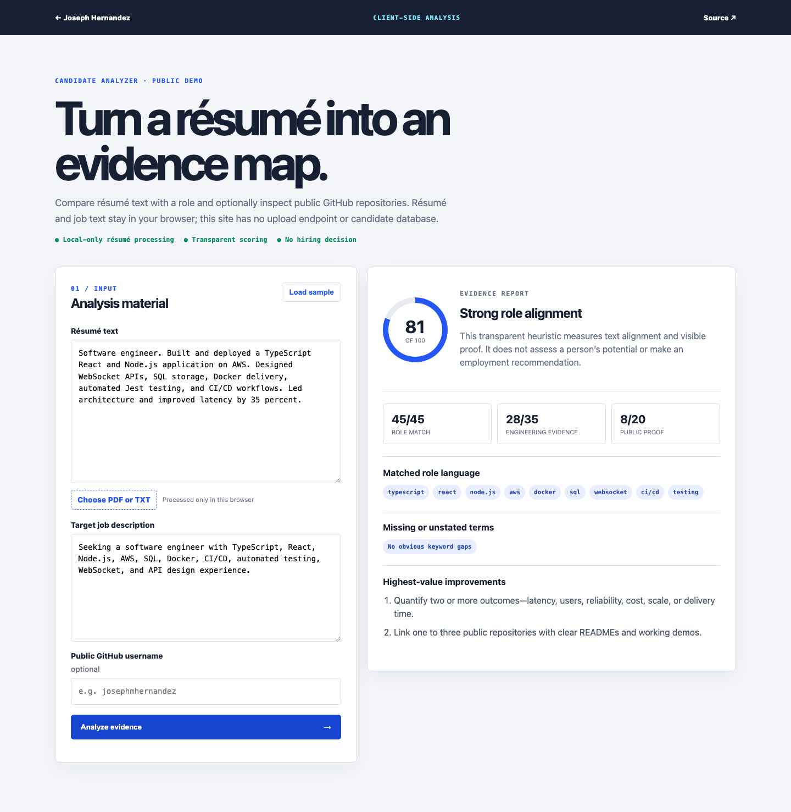

# Candidate Analyzer Demo

A privacy-first public demonstration of résumé-to-role comparison and visible GitHub evidence analysis.

**Live demo:** <https://josephmhernandez.com/demos/candidate/>



## Why this version exists

The original Candidate Analyzer included authentication, subscriptions, payments, Supabase, job queues, and multiple analyzer services. This portfolio version removes payments and account management to make the core interaction safe and immediately testable.

## Features

- Paste résumé and job-description text
- Read PDF or text files locally in the browser
- Compare explicitly disclosed technical terms
- Inspect public GitHub repository metadata
- Produce transparent category scores and concrete improvement suggestions
- Bundled synthetic example for a reliable walkthrough

## Privacy

Résumé and job-description content never leave the browser. There is no upload endpoint, database, analytics tracker, authentication system, or payment flow. Optional GitHub analysis calls GitHub's public API directly from the visitor's browser.

## Limitations

This is an explanatory heuristic, not a validated employment assessment. It does not recommend hiring or rejection and should not be used as the sole basis for an employment decision.

## Run locally

```bash
python3 -m http.server 8080 --directory web
```

Then open <http://localhost:8080>.

## License

MIT
